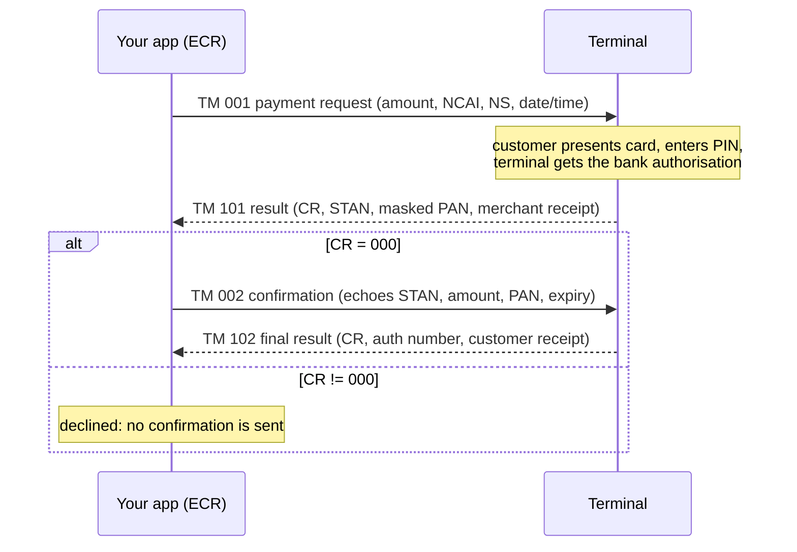
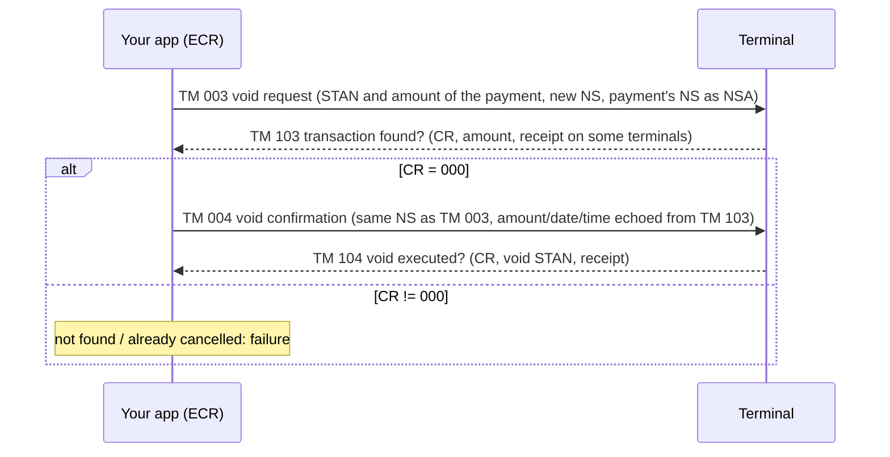

# TKPay NAPS iOS SDK

TKPayNaps is a Swift package that lets an iOS (or macOS) point-of-sale app drive a
NAPS Pay payment terminal. Your app (the "ECR", electronic cash register) asks the
terminal to take a card payment, void a payment or print reports. The terminal
handles the card and the bank, then answers with the result and receipt lines.

The SDK speaks the NAPS Pay ECR TLV protocol (Specification v2.0, NapsPay v5.4.4)
**over TCP/IP only**:

| Terminal (spec §2) | Connection the terminal offers | Supported by this SDK |
|---|---|---|
| Sunmi P2 | Wi-Fi TCP port 4444, USB | Yes, Wi-Fi TCP |
| Sunmi P3 | Wi-Fi TCP port 4444, USB | Yes, Wi-Fi TCP |
| Sunmi P2 Smart PAD | Wi-Fi TCP port 4444, USB | Yes, Wi-Fi TCP |
| Ingenico Self 5000 | USB only | No |
| Ingenico Lane 3600 | USB only | No |

iOS has no API for a USB serial link to these terminals, so USB connections are not
supported. The phone or tablet must be on the same network as the terminal.

> Part of the NAPS SDK family. The [C# SDK](https://github.com/Belkouche/tkpay-sdk-pos-naps-csharp)
> is the reference implementation. Siblings:
> [Node.js](https://github.com/Belkouche/aslan-naps-node) ·
> [Android](https://github.com/Belkouche/tkpay-sdk-pos-android) ·
> [React Native](https://github.com/Belkouche/tkpay-sdk-pos-rn).

## Contents

1. [Install](#install)
2. [Quickstart](#quickstart)
3. [How a payment works](#how-a-payment-works)
4. [How a void works](#how-a-void-works)
5. [Other operations](#other-operations)
6. [Receipts, PAN masking and response codes](#receipts-pan-masking-and-response-codes)
7. [Errors and timeouts](#errors-and-timeouts)
8. [Network traffic](#network-traffic)
9. [Testing with the emulator](#testing-with-the-emulator)
10. [Troubleshooting](#troubleshooting)
11. [Changelog](#changelog)

## Install

Requirements: iOS 13+ or macOS 10.15+, Swift 5.7+ (Xcode 14+). No dependencies.

Swift Package Manager, in `Package.swift`:

```swift
dependencies: [
    .package(url: "https://github.com/Belkouche/tkpay-sdk-pos-naps-ios.git", from: "1.4.0")
]
// and add "TKPayNaps" to your target's dependencies
```

Or in Xcode: **File → Add Package Dependencies…**, enter
`https://github.com/Belkouche/tkpay-sdk-pos-naps-ios.git`, add the `TKPayNaps` library.

On iOS 14+, talking to a device on the local network needs this in your app's `Info.plist`:

```xml
<key>NSLocalNetworkUsageDescription</key>
<string>Required to communicate with the payment terminal</string>
```

## Quickstart

One payment of 150.00 MAD against a terminal or the emulator on `127.0.0.1`. This is
the code of [`Example/Quickstart`](Example/Quickstart/Sources/Quickstart/main.swift):

```swift
import Foundation
import TKPayNaps

let port = Int(ProcessInfo.processInfo.environment["NAPS_PORT"] ?? "") ?? 4444
let client = NapsPayClient(config: NapsConfig(host: "127.0.0.1", port: port))

guard await client.testConnection() else {
    print("Terminal unreachable on 127.0.0.1:\(port)")
    exit(1)
}

let result = try await client.processPayment(
    PaymentRequest(amount: 150.00, registerId: "01", cashierId: "00001"))

if result.isApproved {
    print("Approved: STAN \(result.stan ?? "-"), card \(result.maskedCardNumber ?? "-")")
    print(result.customerReceipt?.toPlainText() ?? "(no receipt)")
} else {
    print("Not approved: CR \(result.responseCode), \(result.error ?? "")")
}
```

Run it against the emulator (see [Testing with the emulator](#testing-with-the-emulator)):

```bash
python3 ../tkpay-naps-emulator/naps_emulator.py --port 4444 &
cd Example/Quickstart && swift run
```

Output (the customer copy, exactly as the terminal sent it):

```text
Approved: STAN 917682, card 516794******3315
                 TKpay
--------------------------------
07/11/2026 00:14:32
TKPAY DEMO
CASABLANCA
--------------------------------
VISA
516794******3315
Terminal: 00000001
Transaction: 917682
Autorisation: 388581
STAN: 917682
--------------------------------
MONTANT: 150.00 MAD
--------------------------------
DEBIT
Copie Client
```

On a real terminal, replace `127.0.0.1` with the terminal's IP address (shown in the
NapsPay app, assigned by your router).

Identifiers you pass to every call:

- `registerId`: 2 digits identifying the till, e.g. `"01"`.
- `cashierId`: 5 digits identifying the cashier, e.g. `"00001"`.
- Together they form the NCAI field (tag 003) that the terminal echoes back.

## How a payment works

A payment is two request/response exchanges **on the same TCP connection**.
`processPayment` does both for you:



1. **Phase 1.** The SDK sends TM 001 and waits up to `timeout` (default 120 s) while the
   customer pays. A non-`000` code ends the payment: you get `success == false`, the
   code, its description and the refusal receipt if the terminal sent one.
2. **Phase 2.** On `000`, the SDK sends the confirmation TM 002 on the same connection,
   echoing the STAN, amount, masked PAN and expiry. It waits up to
   `confirmationTimeout` (default 40 s). The payment is approved only if TM 102 also
   returns `000`. A refused confirmation (for example `307`) is reported as not approved.

`result.isApproved` is true only when both phases succeeded. The merchant receipt
comes from phase 1 and the customer receipt from phase 2. Keep `result.stan`: you need
it to void the payment or reprint its receipt.

`PaymentRequest.sequence` (NS, 6 digits) is optional. When omitted the client
generates one. A sequence that is not 6 characters throws before anything is sent.

## How a void works

A void (cancellation) is also two exchanges on one connection. `cancelPayment` does both:



The frames follow spec v2 §4.3/§4.4. TM 003 carries TM, NCAI, NS, DA, HE, DATR, HETR,
STAN, MT and NSA. Its NS is a new sequence the SDK generates for the void; the
`sequence` you pass is the NS of the payment being voided and goes in NSA. TM 004
carries TM, NCAI, the same NS as TM 003, STAN, MT and DE echoed from TM 103 (DE `504`
if absent), DATR and HETR echoed from TM 103, DA and HE. TM 004 never carries NSA.

TM 103 with `000` only means "transaction found". The reversal is executed by TM 004,
and only TM 104 says whether it happened. The result therefore has three states:

| Outcome | When | `success` | `pending` |
|---|---|---|---|
| **Success** | TM 104 returns `000` or `480` | `true` | `false` |
| **Pending** | TM 104 returns `995`, or no TM 104 arrives within `confirmationTimeout` | `false` | `true` |
| **Failure** | TM 103 refuses (e.g. `302` not found, `482` already cancelled) or TM 104 returns any other code, or a connection error | `false` | `false` |

On success `stan` is the void's own STAN from TM 104. When the void is pending, `stan`
is the **original payment's STAN** and `merchantReceipt` holds the TM 103 receipt, so
you can check what happened:

```swift
let void = await client.cancelPayment(
    stan: payment.stan ?? "",   // STAN of the payment to void
    registerId: "01",
    cashierId: "00001",
    sequence: payment.sequence ?? "",   // NS of the payment, sent as NSA; the void gets its own NS
    amountCentimes: 15000)      // original amount in centimes (required by v5.4.4)

if void.success {
    print("Voided, void STAN \(void.stan ?? "-")")
    print(void.customerReceipt?.toPlainText() ?? "")
} else if void.pending {
    // Outcome unknown: the terminal may or may not have reversed the payment.
    // Do not retry blindly. Fetch the terminal's record for the original STAN
    // and have the operator check it before deciding.
    let record = try await client.duplicateReceipt(stan: void.stan)
    print("Void unconfirmed (\(void.error ?? "")). Terminal record:")
    print(record.merchantReceipt?.toPlainText() ?? "(no receipt)")
} else {
    print("Void failed: CR \(void.responseCode), \(void.error ?? "")")
}
```

Void receipt: when TM 103 carries a receipt, it is `merchantReceipt` and the TM 104
receipt is `customerReceipt`. When TM 103 carries none and TM 104 does, as on the
Sunmi P2 (which prints it "Copie Commerçant") and the Ingenico Lane3600, the TM 104
receipt is returned as `merchantReceipt` and `customerReceipt` is `nil`.

`cancelPayment` never throws: connection errors come back as a failure with
`responseCode == ""` and the message in `error`. A second void of a payment that was
already voided is refused with `482`.

## Other operations

Each operation opens its own connection, sends one request and returns the parsed
reply. All take optional `registerId` (default `"01"`) and `cashierId` (default `"00001"`).
Except for `settlement` and `testConnection`, they throw a `NapsError` on connection
failure or timeout.

**Connection check.** Opens and closes a TCP connection with a 5 s timeout. Nothing is
sent to the terminal.

```swift
let reachable = await client.testConnection()
```

**Network test** (TM 009). Not supported over TCP, so not supported by this SDK:
`networkTest()` sends nothing and returns `success == false` with
`responseCode == "UNSUPPORTED"`. The NapsPay app on Sunmi terminals does not implement
TM 009 (it answers TM 101 with CR 902), and a test frame crashed the app on a Sunmi P2.
TM 009 is only answered over USB serial (Ingenico Lane3600).

```swift
let ping = try await client.networkTest()   // always "UNSUPPORTED" over TCP
```

**Duplicate receipt** (TM 008). Reprints the receipt of a payment from the current
business day by STAN, or of the last transaction when `stan` is omitted. Returns a
`PaymentResult`; the receipt is in `merchantReceipt`.

```swift
let copy = try await client.duplicateReceipt(stan: "123456")
if copy.success {
    print(copy.merchantReceipt?.toPlainText() ?? "")
}
```

**Totals** (TM 010). The day's payment totals for this register, as receipt text.

```swift
let totals = try await client.totals()
if totals.success {
    print(totals.receiptText ?? "")
}
```

**Settlement** (end of day). Also sends TM 010, without a sequence number, and never
throws: errors come back in `error` (`052` "Already settled today", `909` "Terminal or
server is down").

```swift
let settlement = await client.settlement(registerId: "01", cashierId: "00001")
print(settlement.success ? "Settled" : settlement.error ?? "")
```

**Referencing** (TM 013). Makes the terminal download its parameters from the NAPS
server. Required before the terminal can take payments. `TLVProtocol.Tide.merchant`
(`"01"`) loads merchant parameters, `TLVProtocol.Tide.recharge` (`"02"`) top-up
parameters. Spec §7 says this can take more than 2 minutes, so give it a client with a
longer `timeout`.

```swift
let slow = NapsPayClient(config: NapsConfig(host: "192.168.1.50", timeout: 300))
let ref = try await slow.referencing(tide: TLVProtocol.Tide.merchant)
print(ref.success ? (ref.receiptText ?? "") : "Referencing failed: \(ref.responseCode)")
```

**Reset PIN pad** (TM 012). Maintenance command; the reply is not inspected.

```swift
try await client.resetPinPad()
```

## Receipts, PAN masking and response codes

**Receipts.** The receipt is the DP block (tag 010) the terminal sends, in the
layout defined for the interbank network (spec §5). Each line has four sub-tags:

| Sub-tag | Field | SDK |
|---|---|---|
| 030 | line number | `ReceiptLine.lineNumber` |
| 031 | `S` normal / `G` bold | `ReceiptLine.bold` |
| 032 | `C` centre / `D` right / `G` left | `ReceiptLine.alignment` (`.center`, `.right`, `.left`) |
| 033 | text | `ReceiptLine.text` |

Lines are separated by `*` and the block may end with `?`. The SDK reads each sub-tag
by its declared length, so a `*` or `?` inside the text (such as the masked PAN
`516794******3315`) stays part of the line. It keeps every line, in order, exactly as
sent. It adds no header or footer and drops no line; the only change is masking a full
PAN if one appears in the text.

Which copy is where:

| Operation | `merchantReceipt` | `customerReceipt` |
|---|---|---|
| Approved payment | TM 101 ("Copie Commercant") | TM 102 ("Copie Client") |
| Declined payment | refusal receipt from TM 101, if sent | `nil` |
| Void, success | TM 103 ("ANNULATION", "Copie Commercant") | TM 104 ("ANNULATION", "Copie Client") |
| Void, TM 103 without receipt (Sunmi P2, Lane3600) | TM 104 | `nil` |
| Void, pending | TM 103 | TM 104 if it carried one (995), else `nil` |
| Duplicate (`duplicateReceipt`) | TM 108 | `nil` |

`totals()` (TM 110) and `referencing()` (TM 113) return the parsed receipt in
`receipt`, plus the raw DP string in `receiptText`.

Print both copies of a payment:

```swift
let payment = try await client.processPayment(
    PaymentRequest(amount: 10.00, registerId: "01", cashierId: "00001"))
if payment.isApproved {
    print(payment.merchantReceipt?.toPlainText() ?? "(no merchant copy)")   // keep
    print(payment.customerReceipt?.toPlainText() ?? "(no customer copy)")   // hand over
}
```

`toPlainText(width:)` renders one text line per receipt line, padding centred and
right-aligned lines to `width` (default 40). To drive a printer, use each line's
metadata instead:

```swift
for line in payment.customerReceipt?.lines ?? [] {
    // e.g. printer.setBold(line.bold); printer.setAlignment(line.alignment)
    print(line.lineNumber, line.bold ? "bold" : "normal", line.alignment, line.text)
}
```

The customer copy of a 10.00 MAD payment on the emulator renders as (each line trimmed):

```text
TKpay
--------------------------------
07/11/2026 00:12:10
TKPAY DEMO
CASABLANCA
--------------------------------
VISA
516794******3315
Terminal: 00000001
Transaction: 514135
Autorisation: 635927
STAN: 514135
--------------------------------
MONTANT: 10.00 MAD
--------------------------------
DEBIT
Copie Client
```

The merchant copy ends with "Copie Commercant". The void copies have "ANNULATION"
in place of "DEBIT".

**Card numbers.** Card numbers are masked (first 6 + last 4 digits, e.g.
`516794******3315`) as soon as the terminal's reply is read, and the full number is
never exposed or logged.

- The card number field (tag 007) is always returned as first 6 digits, `*` for
  each middle digit, last 4 digits (`516794******3315`), whatever grouping it
  arrived in.
- In receipt lines and other text, any run of 13 or more digits is masked. Within a
  run, digits are adjacent or separated by exactly one space, dash, dot, tab or
  non-breaking space. Every digit except the first 6 and last 4 of the run becomes
  `*`; separators stay, so lines keep their exact layout and length. Dates and times
  (`07/11/2026 00:12:10`), amounts (`10.00`, `1 250,00`), STAN, terminal and
  authorisation numbers, and shorter runs are left alone. Results,
receipts, `receiptText`, error messages and the reply
returned by `NapsConnection.sendAndReceive` all carry the masked number. The SDK does
not log frames. The helpers are public:

```swift
TLVProtocol.maskCardNumber("5167 9400 0012 3315")               // "516794******3315"
TLVProtocol.maskCardNumbersInText("Carte 5167.9400.0012.3315") // "Carte 5167.94**.****.3315"
```

**Response codes.** The CR field (tag 013) is in `responseCode`. The full spec §6 table
is in `TLVProtocol.responseCodes` (see `Sources/TKPayNaps/TLVProtocol.swift`):

```swift
TLVProtocol.describeResponse("116")   // "Insufficient funds"
TLVProtocol.isApproved("001")         // true: 000, 001, 003 and 007 are approval codes
let all = TLVProtocol.responseCodes   // [String: String]
```

`PaymentResult.isApproved` is stricter than `TLVProtocol.isApproved`: it requires
`000` on both phases. Codes you will meet most often:

| Code | Meaning |
|---|---|
| 000 | Approved / success |
| 100 | Do not honour |
| 116 | Insufficient funds |
| 117 | Incorrect PIN |
| 302 | Record not found (void of an unknown STAN) |
| 307 | Format error (e.g. confirmation does not match the payment) |
| 480 | Reversal accepted (void succeeded) |
| 482 | Transaction already cancelled |
| 909 | System failure (terminal or server down, or a required field missing) |
| 995 | Server processing error (on a void: pending, see above) |

## Errors and timeouts

```swift
let config = NapsConfig(
    host: "192.168.1.50",       // terminal IP
    port: 4444,                 // default 4444
    timeout: 120,               // connect + each request, seconds (default 120)
    confirmationTimeout: 40,    // TM 002 and TM 004 replies, seconds (default 40)
    protocolVersion: .v2)       // .v2 (default, '!' terminator) or .v1 ('?')
```

- `timeout` bounds the TCP connect and every reply except the two confirmations.
  The 120 s default covers the time a customer needs at the terminal.
- `confirmationTimeout` bounds the TM 102 and TM 104 replies.
- A reply ends at a `!` or `?` terminator found on a field boundary (fields are walked by
  their length). A `!` or `?` inside a value, such as a receipt line ending in `?`, is
  data. Some replies (TM 103/104 on v5.4.4) have no terminator: the SDK then treats 1 s
  of silence after the last bytes as the end of the reply. Replies over 64 KB are
  rejected with `.invalidResponse`.
- A receipt (DP) declared 999 long runs to its own `?` end marker: some terminals write
  999 when the receipt is longer.
- Requests are sent without a `!` or `?` terminator (a `!`-terminated frame got no
  reply from a Sunmi P2).

Throwing calls throw `NapsError`, whose `code` is a `NapsErrorCode` and whose `message`
is also its `localizedDescription`:

```swift
do {
    let result = try await client.processPayment(
        PaymentRequest(amount: 150.00, registerId: "01", cashierId: "00001"))
    print(result.isApproved ? "Approved" : "Declined: \(result.error ?? "")")
} catch let error as NapsError {
    switch error.code {
    case .connectionFailed: print("Cannot reach the terminal: \(error.message)")
    case .timeout:          print("No reply in time")
    case .invalidResponse:  print("Rejected or malformed: \(error.message)")
    default:                print(error.message)
    }
}
```

Which call reports errors how:

| Call | Declined / refused | Connection error, timeout |
|---|---|---|
| `processPayment` | returns `success == false` with `responseCode` and `error` | throws `NapsError` |
| `cancelPayment` | returns failure or `pending` | returns failure (`responseCode == ""`); a missing TM 104 returns `pending` |
| `settlement` | returns `success == false` with `error` | returns `success == false` |
| `networkTest` | always `success == false`, `responseCode == "UNSUPPORTED"` (nothing is sent) | never contacts the terminal |
| `totals`, `referencing`, `duplicateReceipt`, `resetPinPad` | returns `success == false` (or nothing for `resetPinPad`) | throws `NapsError` |
| `testConnection` | n/a | returns `false` |

`processPayment` also throws `.invalidResponse` before connecting when the request is
invalid (amount not positive, `registerId` not 2 characters, `cashierId` not 5,
`sequence` not 6), and when phase 2 is not a TM 102 reply.

A timeout during phase 2 of a payment throws `.timeout`, but the terminal may already
have authorised the card. Check with `duplicateReceipt()` before taking the payment again.

## Network traffic

The SDK only talks to the terminal. It sends nothing to any server.

## Testing with the emulator

The [NAPS emulator](https://github.com/Belkouche/tkpay-naps-emulator) is a Python 3
(standard library only) program that behaves like a terminal, so you can develop
without hardware:

```bash
python3 ../tkpay-naps-emulator/naps_emulator.py --port 4444
```

Point the SDK at `127.0.0.1:4444`. Useful `--mode` values:

| Mode | Behaviour |
|---|---|
| `approve` (default) | Approves every payment and void |
| `decline` | Declines payments (CR 100) |
| `error --code 116` | Phase 1 returns the given code (any CR or scenario name) |
| `confirm_error --code 302` | Phase 1 approves, the confirmation is refused with the code |
| `no_confirm` | No reply to TM 002 (payment confirmation timeout) |
| `timeout` | No reply to TM 001 |
| `interactive` | Asks on the console to approve or decline each payment |
| `void_480` | TM 104 returns 480 (void success) |
| `void_995` | TM 104 returns 995 (void pending) |
| `void_no_confirm` | No reply to TM 004 (void pending) |
| `void_refuse --code 482` | TM 103 refuses the void with the code (e.g. 302, 482) |

Other flags: `--protocol v1` ends replies with `?`, `--strict-confirm` refuses a
confirmation whose amount or PAN does not match the payment, and `--debug` prints every
field.

**This repo's tests:**

```bash
swift build
swift test                                    # unit + in-process fake-terminal tests
```

Integration tests run only when `NAPS_EMULATOR_PORT` is set. Each test belongs to one
emulator mode. Set `NAPS_EMULATOR_MODE` (and `NAPS_EMULATOR_CODE` for modes that take
`--code`) to match how you started the emulator:

```bash
python3 ../tkpay-naps-emulator/naps_emulator.py --port 4455 --mode void_refuse --code 482 &
NAPS_EMULATOR_PORT=4455 NAPS_EMULATOR_MODE=void_refuse NAPS_EMULATOR_CODE=482 swift test
```

Modes with tests: `approve`, `decline`, `error`, `confirm_error`, `no_confirm`,
`timeout`, `void_480`, `void_995`, `void_no_confirm`, `void_refuse`.

## Troubleshooting

| Symptom | Likely cause and fix |
|---|---|
| `testConnection()` returns `false`, or `.connectionFailed` | Wrong IP or port, the device is on another network or Wi-Fi isolation is on, NapsPay is not running on the terminal, or the local-network permission was denied (iOS Settings → Privacy → Local Network). Check that port 4444 is reachable from the device. |
| `.timeout` on a payment | Nobody presented a card within `timeout`, or the terminal is not on its "waiting for till" screen. If it happens in phase 2, check with `duplicateReceipt()` before retrying. |
| CR `909` | Terminal or NAPS server unreachable (check the terminal's network), referencing never done (run `referencing()`), or a required field missing (TM 004 without amount: pass `amountCentimes` to `cancelPayment`). |
| CR `302` on a void | No transaction with that STAN in the current business day. Check the STAN and that the payment was made today on this terminal. |
| CR `482` on a void | The payment was already voided. Treat as done; do not retry. |
| Void returns `pending` | TM 104 was `995` or never arrived. The reversal may or may not have happened. Use `duplicateReceipt(stan: void.stan)` and check before any retry. |
| CR `307` | A request did not match what the terminal expected, e.g. a confirmation whose amount or PAN differs from the payment. |
| CR `052` on settlement | Already settled today. |

## Changelog

See [CHANGELOG.md](CHANGELOG.md). Version 1.3.0 is the NapsPay v5.4.4 sync: reply
framing, per-phase receipts, management operations and the spec-correct void flow
with the `pending` state.

## License

MIT. See [LICENSE](LICENSE).
